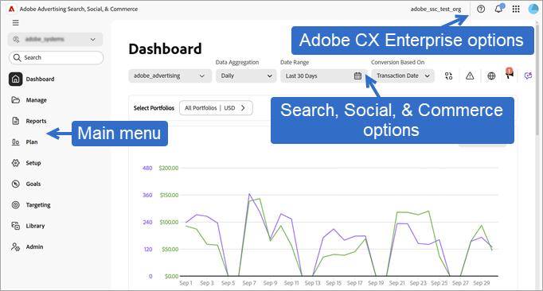

# Organisation der Benutzeroberfläche

## Neue Benutzeroberfläche

*Beta-Funktion*

Jede Seite enthält das Hauptmenü sowie weitere aufgabenbasierte und informationsbasierte Menüs.

Ihr [Produktprofil](/help/search-social-commerce/user-administration.md#default-product-profiles) bestimmt die verfügbaren Optionen, einschließlich der in den einzelnen Ansichten verfügbaren Funktionen.

## Das Hauptmenü

Die neue Benutzeroberfläche verfügt auf der linken Seite über ein neues Hauptmenü, in dem die Aufgaben nach Arbeitsphase organisiert werden.

### Optionen im Hauptmenü

* (Falls zutreffend) Eine auswählbare Liste von Advertisern, die Sie verwalten, über dem Suchfeld im erweiterten linken Navigationsbereich.

* Ein Suchfeld für Optionen im Hauptmenü.

* **[!UICONTROL Dashboard]** Untermenü:

  * **[!UICONTROL Overview]** Visualisieren Sie die Leistung aller Ihrer Portfolios, Portfoliogruppen oder Optimierungsziele.

  * **[!UICONTROL Recommendations]**: Listen Sie Ihre Publisher-Empfehlungen aus [!DNL Google Ads] und [!DNL Microsoft Advertising] auf und erhalten Sie Publisher-Einblicke aus [!DNL Microsoft Advertising.] Sie können optional Empfehlungen anwenden.

* **[!UICONTROL Manage]** Untermenü:

  * **[!UICONTROL Portfolios]:** Listen und verwalten Sie alle Portfolios für den Advertiser. Sie können eine Liste der zugewiesenen Einschränkungen öffnen und Leistungs- und Kompositionsdetails für jedes Portfolio anzeigen.

    Die Portfolioeinstellungen umfassen Registerkarten zum Zuweisen der Ziele und Kampagnen, Verwalten von Ausgaben, Verwalten von Einschränkungen und Steuern der Optimierung. Nur Benutzer mit dem Profil „Expertenoptimierung“ oder höher können die Einstellungen auf der Registerkarte &quot;[!UICONTROL Control Optimization]&quot; bearbeiten.

  * **[!UICONTROL Networks]**: (Schreibgeschützt) Sehen Sie sich die Kosten, Klicks, Kosten pro Klick (CPC), Impressionen und den Zielwert für jede Kombination aus Anzeigennetzwerk und Währung an, die über eine API-Verbindung synchronisiert oder über den Daten-Upload eingerichtet wird.

  * **[!UICONTROL Accounts]**: Listen und verwalten Sie Anzeigennetzwerkkonten, die über eine API-Verbindung synchronisiert oder über den Daten-Upload eingerichtet werden. Sie können auch vorhandene [!UICONTROL Naver] verwalten.

  * **[!UICONTROL Campaigns]:** Listen und verwalten Sie alle Kampagnen für den Advertiser. Sie können Kampagnen Portfolios zuweisen und Beschriftungs- und Einschränkungszuweisungen für ausgewählte Kampagnen verwalten. Darüber hinaus können Sie [!DNL Google Ads] Kampagnen in [!DNL Microsoft Advertising] replizieren.

  * **[!UICONTROL Ad Groups]:** Listen und verwalten Sie alle Anzeigengruppen für den Advertiser. Sie können Beschriftungs- und Einschränkungszuweisungen für ausgewählte Anzeigengruppen verwalten.

  * **[!UICONTROL Ads]** Listen und verwalten Sie alle Anzeigen für den Advertiser. Sie können Beschriftungs- und Einschränkungszuweisungen für ausgewählte Anzeigen verwalten.

  * **[!UICONTROL Keywords]** Auflisten und Verwalten vorhandener Keywords und negativer Keywords für den Advertiser. Sie können Beschriftungs- und Einschränkungszuweisungen für ausgewählte Keywords verwalten.

  * **[!UICONTROL Product Groups]** Auflisten und Verwalten vorhandener Warengruppen. Sie können Beschriftungs- und Einschränkungszuweisungen für ausgewählte Produktgruppen verwalten.

* **[!UICONTROL Reports]** Untermenü:

  * **[!UICONTROL Insights]**: Generieren Sie visuelle, verwertbare Daten, mit denen Sie die Portfolioleistung bewerten, Optimierungsprobleme identifizieren und Konversionsdaten vergleichen können.

  * **[!UICONTROL Reports]**: Generieren und Verwalten benutzerdefinierter Berichte und Berichtsvorlagen.

  * **[!UICONTROL Spreadsheet Feeds]**: Anzeigen und Einrichten von Report Feeds, die täglich aktualisiert werden.

  * **[!UICONTROL History Logs]**: Anzeigen der letzten Änderungen am Advertiser-Konto.

* **[!UICONTROL Plan]** Untermenü:

  * **[!UICONTROL Simulations]** Listen Sie alle benutzerdefinierten und automatisch generierten wöchentlichen Simulationen auf, generieren Sie neue benutzerdefinierte Simulationen und führen Sie vorhandene Simulationen erneut aus.

  * **[!UICONTROL Spend Planner]** Erstellen und wenden Sie Budgetempfehlungen für das Portfolio an, um eine optimale Ausgabenverteilung auf Ihre Portfolios zu erreichen.

* **[!UICONTROL Set Up]** Untermenü:

  * **[!UICONTROL Bulksheets]**: Herunterladen und Hochladen von Bulksheet-Dateien mit Kampagnendaten in Ihre Werbenetzwerke.

  * **[!UICONTROL Label Classification]** Klassifizierungen auflisten und verwalten, einschließlich der Zuweisung/Aufhebung der Zuweisung von Klassifizierungswerten zu Kampagnen und Kampagnenkomponenten.

  * **[!UICONTROL Manager Accounts]**: Auflisten und Verwalten von Manager-Konten in Ihren Werbenetzwerken.

* **[!UICONTROL Goals]** Untermenü:

  * **[!UICONTROL Objectives]** Auflisten und Verwalten von Optimierungszielen.

  * **[!UICONTROL Conversions]** Listen Sie die verfolgten Konversionsmetriken des Advertisers auf und passen Sie die Metriken an, die für Verwaltungsansichten und Berichte verfügbar sind.

  * **[!UICONTROL Conversion Value Rules]** Regeln für Konversionswerte auf Kampagnenebene und Kontoebene für [!DNL Google Ads] Konten auflisten und verwalten.

  * **[!UICONTROL Constraints]** Listen und Verwaltung von Gebotsbeschränkungen.

* **[!UICONTROL Targeting]** Untermenü:

  * **[!UICONTROL Audiences]**: Auflisten und Verwalten von Zielgruppen, Zielgruppenzielen und Zielgruppenausschlüssen.

  * **[!UICONTROL Auto Targets]** Auflisten und Verwalten automatischer Ziele. Sie können Beschriftungs- und Einschränkungszuweisungen für ausgewählte automatische Ziele verwalten.

  * **[!UICONTROL Placements]** Platzierungen und negative Platzierungen auflisten und verwalten. Sie können Beschriftungs- und Einschränkungszuweisungen für ausgewählte Platzierungen verwalten.

* **[!UICONTROL Library]** Untermenü:

  * **[!UICONTROL Assets]** Sie Ihre Kreativ-Assets auf und verwalten Sie sie.

  * **[!UICONTROL Extensions]** Sie Ihre Callout-Erweiterungen, Sitelink-Erweiterungen und Verknüpfungen zwischen Ihren Anzeigenerweiterungen und Kontoentitäten auf und verwalten Sie sie.

  * **[!UICONTROL Products]** Öffnet schreibgeschützte Ansichten Ihrer bestehenden Merchant Center-Konten und -Produkte. Um ein Merchant Center-Konto hinzuzufügen, verwenden Sie die Ansicht Legacy [!UICONTROL Campaigns] > [!UICONTROL Products] . Kehren Sie zur alten Benutzeroberfläche zurück, indem Sie auf die Schaltfläche [[!UICONTROL Switch to Old UI] klicken](/help/search-social-commerce/getting-started/ui-switch.md).

<!--
 What's happening to these?

Tools > Generic Tracking
Tools > Inventory Selection
Tools > Admin > Data Source Setup
-->

### Hauptmenü reduzieren

Reduzieren Sie das Hauptmenü, wenn Sie mehr Platz zum Anzeigen von Daten benötigen.

* Klicken Sie über dem Hauptmenü auf der linken Seite auf .

### Anzeigen von Daten für einen anderen Advertiser

* Erweitern Sie das linke Navigationsfenster, wenn es reduziert ist. Öffnen Sie über dem Suchfeld die Liste Advertiser und wählen Sie den Advertiser aus.

  Weitere Informationen und Einschränkungen finden Sie unter [Anzeigen von Daten für einen anderen Advertiser](/help/search-social-commerce/common-tasks/change-advertiser.md).

### Nach Hauptmenüoptionen suchen

Verwenden Sie das Suchfeld über dem Hauptmenü, um nach bestimmten Menüoptionen zu suchen, z. B. „Portfolios“ oder „Berichte“.

## Weitere aufgabenbasierte und informationsbasierte Menüs oben rechts

### Obere Zeile: CX Enterprise-Menü

* Eine auswählbare Liste von CX Enterprise-Organisationen, auf die Sie Zugriff haben.

*  Ein Hilfemenü mit Links zu Dokumentationen und anderen Informationen.

*  Ein Bedienfeld, in dem Anfragen, Benachrichtigungen und Ankündigungen von CX Enterprise aufgelistet sind.

*  Eine Liste der Adobe CX Enterprise-Lösungen und -Services, zu denen Sie wechseln können.

*  Informationen zu Ihrem CX Enterprise-Kontoprofil, von dem aus Sie Ihre Voreinstellungen bearbeiten und sich abmelden können.

### Zweite Zeile: Zusätzliches Menü für Suche, Social Media und Commerce

**Hinweis:** Einige Bildschirme verfügen über zusätzliche Optionen.

* Der konfigurierbare Datumsbereich für die aktuelle Ansicht. Wenn der Datumsvergleich unterstützt wird, ermöglicht Ihnen das Steuerelement „Datumsbereich“ auch den Vergleich zweier Zeiträume und die Auswahl, ob die Änderung als Prozentsatz oder als numerische Varianz angezeigt werden soll. Siehe &quot;[Filtern von Daten nach Datumsbereich](/help/search-social-commerce/common-tasks/data-views/ad-hoc-settings/date-filter.md#date-filter-new-ui)&quot;.

*  Öffnet die alte Benutzeroberfläche in einer neuen Registerkarte oder einem neuen Fenster.

*  Ermöglicht Ihnen, benutzerdefinierte Warnhinweise in einem Bedienfeld zu erstellen oder anzuzeigen.

*  Öffnet eine Liste <!--what kind --> Massenvorgangsaufträge.

*  Öffnet ein Bedienfeld, in dem Ihre Benachrichtigungen in den Bereichen Suche, Social und Commerce aufgelistet sind. Sie können die Liste filtern, Ihre Benachrichtigungseinstellungen bearbeiten oder [!UICONTROL Notification Center] öffnen

## Alte Benutzeroberfläche

Oben auf jeder Seite befinden sich das Hauptmenü und andere aufgabenbasierte und informationsbasierte Menüs.

### Das Hauptmenü

* **[!UICONTROL Search, Social, & Commerce]** \> — Zum Verwalten Ihrer Anzeigennetzwerkkonten in Search, Social und Commerce, einschließlich der Konten, für die Search, Social und Commerce verfolgt, aber nicht geboten wird.

### [!UICONTROL Search] Menüs

Die Option [!UICONTROL Search] umfasst die folgenden Untermenüs. Ihre Rolle bestimmt Ihre verfügbaren Optionen:

* **[!UICONTROL Campaigns]** - Dieses Menü enthält Optionen zum Anzeigen und Verwalten von Informationen zu den Werbekonten und Kampagnen, die Sie verwalten oder verfolgen. Abhängig vom Anzeigennetzwerk und Ihrer Rolle können Sie Konten und Kampagnen und deren Komponenten erstellen und bearbeiten. Sie können auch Kennzeichnungsklassifizierungen verwalten, die Sie verschiedenen Kontokomponenten zuweisen können.

* **[!UICONTROL Optimization]** - Dieses Menü bietet Optionen zum Verwalten von Geschäftszielen, Verwalten von Portfolios auf der Grundlage Ihrer Geschäftsziele und Überwachen der Portfolioleistung, Generieren der portfolioübergreifenden [!UICONTROL Spend Recommendation Report], Verwalten von Angebotsbeschränkungen und Anzeigen und Verwalten (einiger Benutzer) Ihrer [!DNL Google Ads]-Konversionswertregeln.

  Eine separate Dokumentation zu diesen Funktionen ist über das Menü [!UICONTROL Help] verfügbar (Menü ).

* **[!UICONTROL Insights & Reports]** - Dieses Menü enthält Optionen zum Generieren detaillierter Einblicke und Berichte, zum Automatisieren der Berichtserstellung mithilfe von Kalkulationstabellen-Feeds, zum Erstellen und Überwachen von Warnhinweisen, zum Konfigurieren Ihrer Benachrichtigungseinstellungen, zum Anzeigen von Netzwerkempfehlungen und zum Anzeigen eines Protokolls der am Advertiser-Konto vorgenommenen Änderungen.

* **[!UICONTROL Tools]** - Dieses Menü enthält Optionen zum Ändern Ihres Kontokennworts, zum Generieren von Tags zum Tracking von Konversionen von Website-Seiten, zum Generieren und Decodieren von Klick-Tracking-URLs und zum Hochladen von Metriken für Suchtracking-Kampagnen.

* **[!UICONTROL Admin]** - Das Menü [!UICONTROL Admin] enthält Optionen zum Ändern der Anzeigenamen der Konversionsmetriken eines Advertisers in Datentabellen und Berichten, zum Konfigurieren von Einstellungen für die Synchronisierung mit einem Adobe Audience Manager-Konto und zum Synchronisieren von Konversionsmetriken für eine bestimmte Kombination aus [!DNL Google Analytics], Eigenschaft und Ansicht . Je nach Ihrer Rolle können Sie damit Advertiser-Konten, Agenturkonten, Benutzerrollen und Benutzerkonten verwalten.

### Weitere aufgabenbasierte und informationsbasierte Menüs auf der rechten Seite

* (falls zutreffend) Eine auswählbare Liste von Advertisern, die Sie verwalten.

*  Ein Bedienfeld, in dem Ihre Benachrichtigungen zu Suche, Social und Commerce aufgelistet sind.

  Wenn Sie über [Adobe CX Enterprise](sign-in.md) angemeldet sind, werden in diesem Bedienfeld Ihre Benachrichtigungen von CX Enterprise angezeigt.

*  Ein Hilfemenü mit Links zu Dokumentationen und anderen Informationen.

*  Eine Liste von Adobe CX Enterprise-Lösungen und -Services, zu denen Sie wechseln können.

*  Ein Link zu Ihrem Profil, über den Sie sich abmelden können.

  Wenn Sie über [Adobe CX Enterprise](sign-in.md) angemeldet sind, können Sie auch Ihr CX Enterprise-Profil bearbeiten, einschließlich Ihres CX Enterprise-Kennworts und Ihrer Benachrichtigungseinstellungen.

>[!MORELIKETHIS]
>
>* [Anmelden](sign-in.md)
>* [Abmelden](sign-out.md)
>* [Wechseln zwischen der neuen und der veralteten Benutzeroberfläche](ui-switch.md)